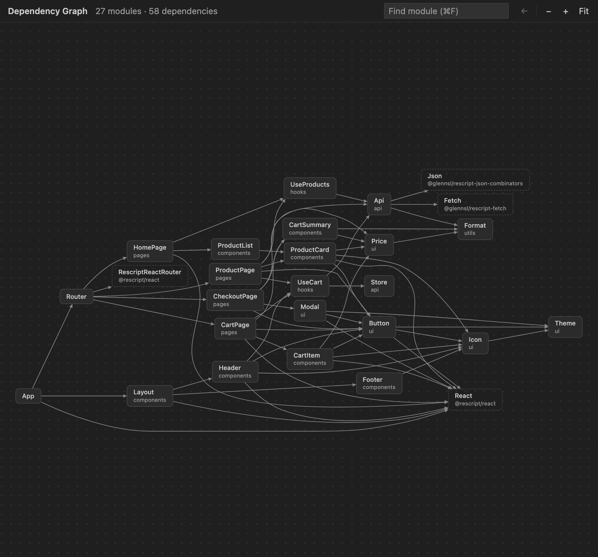
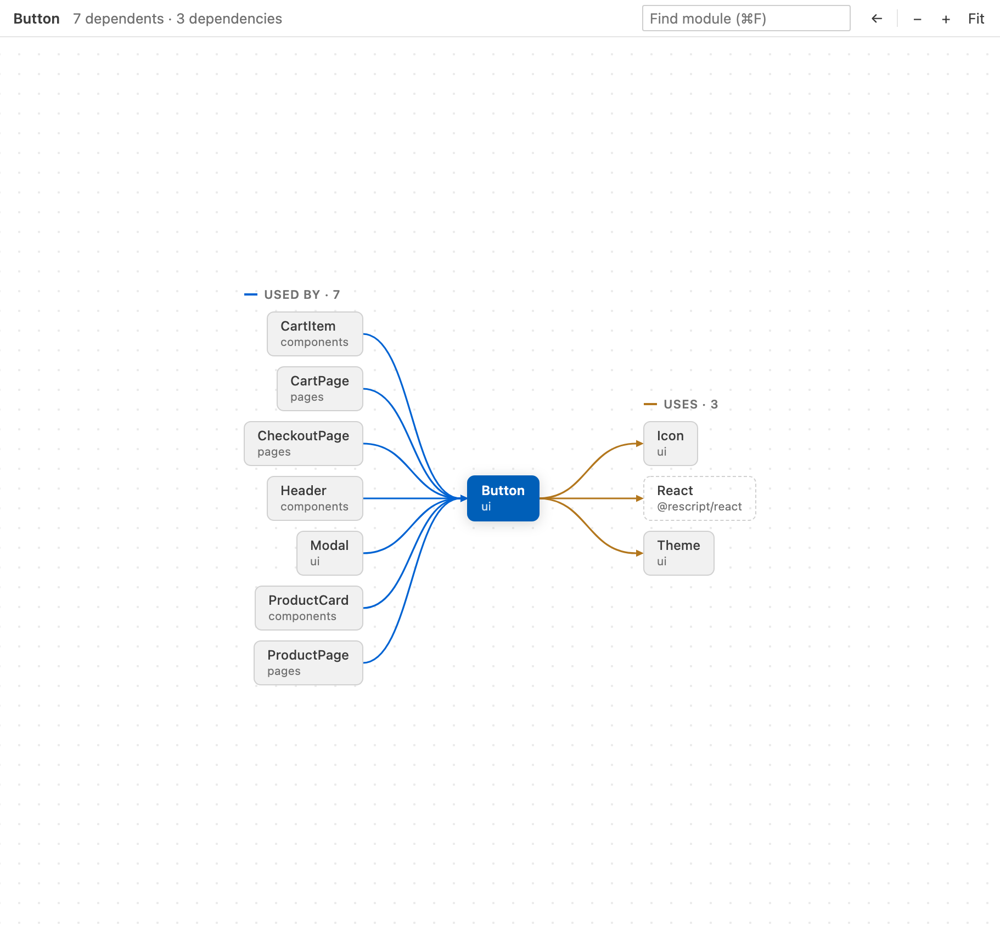
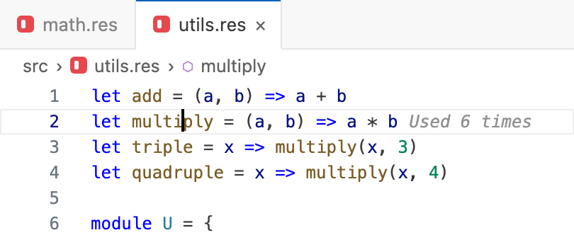

# Bibimbob

A Visual Studio Code extension for visualizing dependencies between ReScript modules in your project. This extension helps you understand the structure and relationships in your ReScript codebase.

## Features

- **Full Dependency Graph Visualization**: View the complete dependency graph of your ReScript project
- **Module-Focused Views**: Focus on a specific module and see its direct dependencies and dependents
- **Unused Module Detection**: Identify modules that have no dependents to help locate potential dead code

- **Interactive Graph**: Click on modules to navigate through dependencies
- **Value Usage Count**: See how many times each let binding is used, directly in the editor
- **Responsive Graph Viewer**: Local Graphviz layout, module search, keyboard navigation, and cancellable analysis; no network connection required for rendering

  
  

## Value Usage Count Annotation

This extension also shows how many times each value (e.g., a function or let binding) is used across your project. When you place your cursor on a `let ... =` declaration in a `.res` file, an inline annotation will appear at the end of the line, such as `Used 0 times`. Partial results appear as `Used N+ times`; unavailable results are not shown. Save and compile your source to refresh analysis. This helps you quickly identify unused or rarely used values.

  

## Platform Support

Currently, this extension is supported on:
- macOS
- Linux

**Important: Windows is not supported in the current version.**

Windows support is planned for a future release. The limitation is due to issues with the CLI binary build process.

## Commands

This extension provides several commands in the Command Palette (`Ctrl+Shift+P` or `Cmd+Shift+P`):

- **Bibimbob: Show Dependency Graph**: Shows the full dependency graph of your project
- **Bibimbob: Focus On Module Dependencies**: Focuses on a specific module and its relationships
- **Bibimbob: Show Unused Modules**: Identifies and visualizes modules that have no dependents (potentially unused code)
- **Bibimbob: Toggle Value Usage Count**: Turns inline value usage count annotations on or off

## Requirements

- A ReScript project (with either `bsconfig.json` or `rescript.json` configuration file)
- ReScript 11, 12 or 13 (see [Supported ReScript Versions](https://github.com/mununki/rescriptdep#supported-rescript-versions))
- Compiled output in the `lib/bs` directory
- **Platform**: macOS or Linux (Windows is not supported in the current version)

## Installation

1. Install the extension from the VS Code Marketplace
2. Open a ReScript project in VS Code
3. Use the Command Palette to run the dependency visualization commands

## Usage Tips

1. **After Major Changes**: When making significant changes to your codebase (including module deletion), run `rescript clean` to recompile your project for improved analysis accuracy
2. **Module Navigation**: Click a module to focus its dependencies. Click the centre module, double-click, or Cmd/Ctrl+click to open its source. Use Back to return to earlier views. The editor-title button focuses the module in that editor.
3. **Pan and Zoom**: Drag the canvas or use the mouse wheel to pan. **Wheel behavior has changed:** hold Ctrl/Cmd while scrolling to zoom around the pointer. Use +, −, or Fit in the toolbar for zoom controls.
4. **Find and Keyboard Navigation**: Cmd/Ctrl+F opens module search. Enter cycles matches; Escape returns focus to the current match. Tab selects controls and modules; Enter or Space activates a module. Shift+F10 opens its context menu.
5. **Context Menus**: Right-click a module to Open, Focus, Copy Module Name, or Copy Relative Path. Right-click the canvas to Fit to View, go Back, or Show Full Graph. Actions depend on the current view and source availability.
6. **Large Graphs**: Use a focused view when the full graph is too large. Analysis and layout can be cancelled. Modules without dependents are candidates for review, not proof that deletion is safe.

## Extension Settings

`bibimbob.valueUsageCount.enabled` (default: `true`) controls inline usage annotations. The **Bibimbob: Toggle Value Usage Count** command updates this setting.

## Known Issues

- Windows platform is not supported in the current version
- Please report any issues on the GitHub repository

## Release Notes

### 0.10.0

- Rebuilt the graph viewer with searchable module cards, dependency tracing, Back navigation, theme support, and local layout.
- Added module and canvas context menus, keyboard navigation, and source-opening shortcuts.
- Plain scrolling now pans; hold Ctrl/Cmd while scrolling to zoom.
- Reused graph panels and cancelled superseded analysis; bounded navigation and usage caches.
- Improved narrow-panel layout, unused-module grids, and actionable error states.
- Refreshed the screenshots using a neutral demo project. The usage annotation image is an illustrative editor mockup.

### 0.9.0

- Added support for ReScript 12 and the ReScript 13.0 alphas; inline value usage counts are not available for 13.0.0-alpha.4
- Fixed inline value usage counts showing an error in ReScript 12 projects
- Fixed dependency graphs of projects using `"namespace": true`, which showed unused imports, ReScript runtime modules and the generated namespace module; inline value usage counts now work in these projects too
- Resolved file paths of modules from packages listed in the ReScript 12 `dependencies` field of `rescript.json`

### 0.8.4

- Improved dependency lookup performance with a reverse dependent index
- Reduced inline value usage analysis work with debounced and cached requests
- Prevented stale inline value usage annotations after source edits or outdated analysis responses

### 0.8.3

- Fixed focused dependency graphs for ReScript namespace builds that generate compiled module names with namespace suffixes such as `DOMAPI-WebAPI`
- Restored internal module edges in focused graphs for namespaced projects so module dependency views no longer collapse to an empty result

### 0.8.2

- Refreshed the macOS extension release pipeline so bundled CLI builds are produced from the default Apple Silicon runner again
- Improved release stability for macOS users by aligning the packaged CLI with the current GitHub Actions macOS environment

### 0.8.1

- Fixed focused module dependency analysis for ReScript namespace projects
- Improved extension packaging metadata for Marketplace and Open VSX releases

### 0.8.0

- Show value usage count as an inline annotation for let bindings.

### 0.7.0

- Added new command "ReScript: Show Unused Modules" to display modules without dependents
- Enhanced visualization with special highlighting for unused modules
- Improved user interaction for large projects with options to switch between view modes
- Added visual indicators and tooltips for unused modules to help identify dead code

### 0.6.0

- Improved dependency graph rendering with optimized layout algorithms
- Added support for filtering modules by namespace
- Improved error handling for invalid project configurations

### 0.5.0

- Added monorepo support: The extension now detects and works with monorepo projects containing multiple ReScript packages
- Improved visualization with better node positioning and relationship indicators
- Enhanced module focus mode with clearer dependency direction highlighting

### 0.4.0

- Added AST-based dependency analysis for more accurate module dependency detection
- Significantly improved performance with optimized caching and parallel processing
- Reduced memory usage through efficient data structures and lazy loading

### 0.3.0

- Added dark theme support: The dependency graph visualization now automatically adapts to your VS Code theme

### 0.2.0

- Added external module visualization: Now properly represents external dependencies in the dependency graph

### 0.1.1

- Fixed compatibility issue by downgrading the VS Code engine requirement to support older VS Code versions

### 0.1.0

- Initial release of Bibimbob
- Dependency graph visualization
- Module-focused views
- Caching for improved performance

---

## For more information

* [ReScript Language](https://rescript-lang.org/)
* [GitHub Repository](https://github.com/mununki/rescriptdep)

**Enjoy!**
